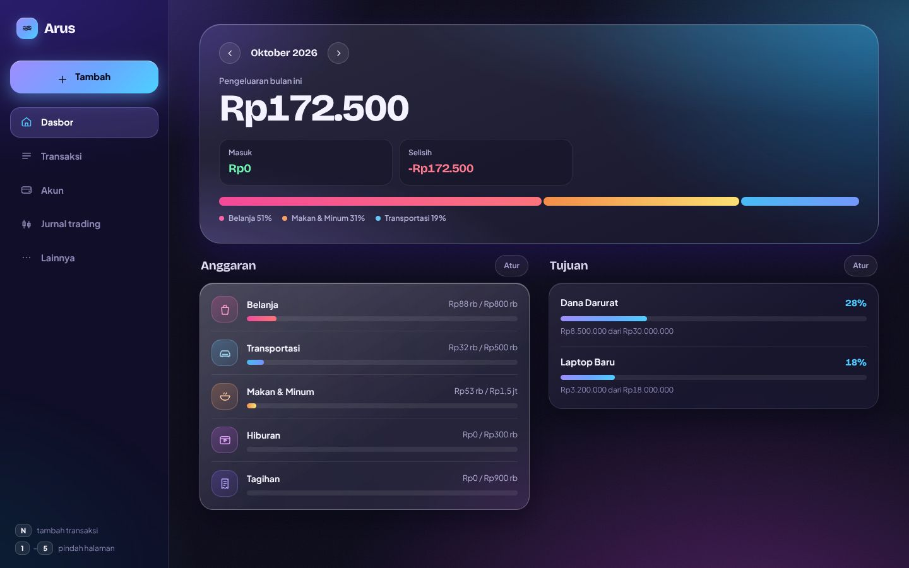
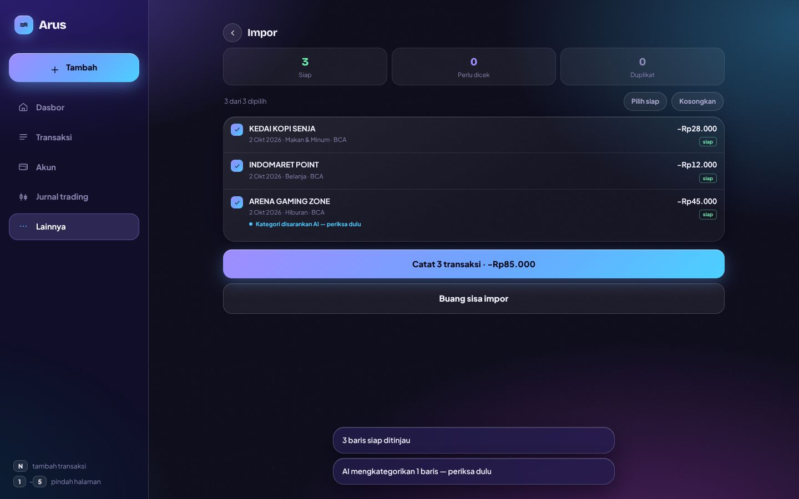
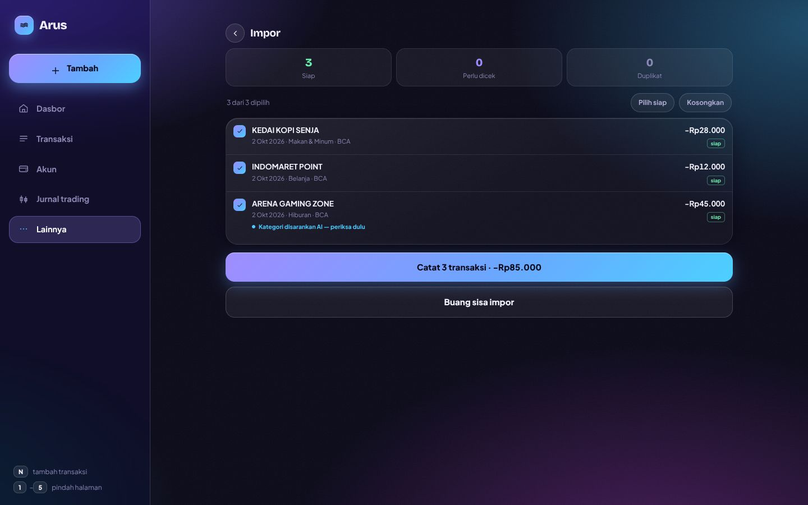
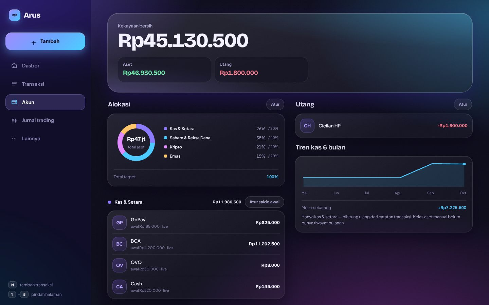
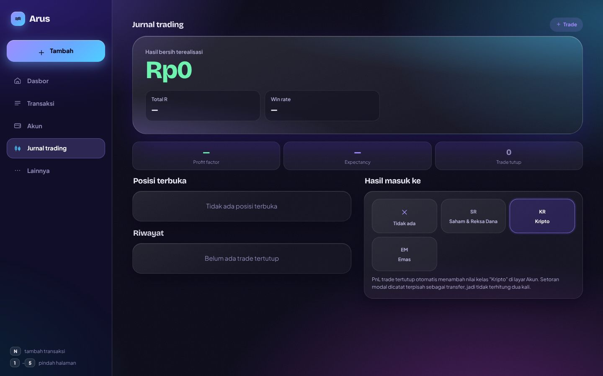
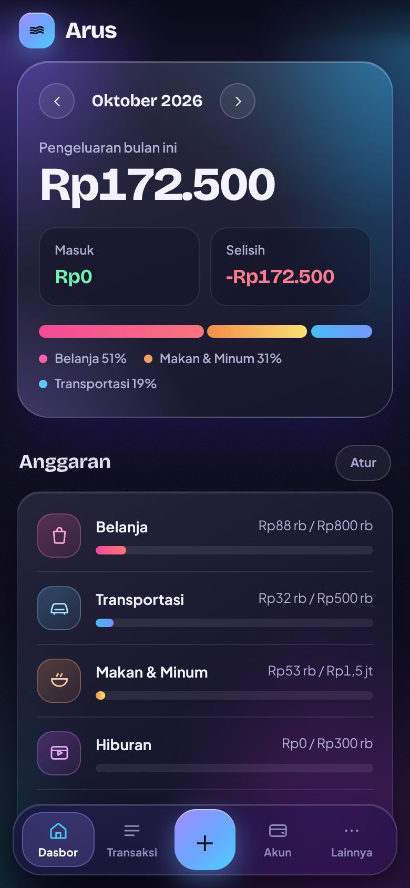
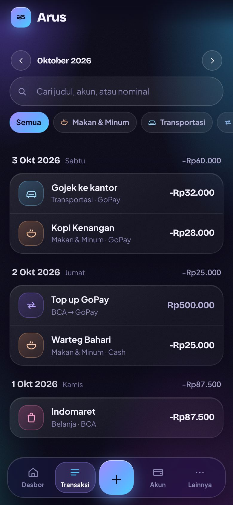

# Arus

Pencatat keuangan pribadi yang **local-first**: datanya tinggal di perangkat, tanpa akun dan tanpa server.
Proyek portofolio — dari satu file HTML 7.900 baris untuk HP, dirombak jadi aplikasi web Vite yang rapi,
punya layout desktop, tampilan glassmorphism, dan kategori transaksi otomatis lewat Gemini yang
mengutamakan privasi.



| | |
|---|---|
|  |  |
|  |  |

<p>
  
  
</p>

## Fitur
- **Dasbor:** ringkasan bulan, pita komposisi pengeluaran per kategori, anggaran, tujuan menabung.
- **Transaksi:** cari, filter kategori, transfer antar akun, transaksi rutin.
- **Akun:** kekayaan bersih, alokasi aset vs target, utang, tren kas 6 bulan. Lima akun: GoPay, BCA, OVO, Cash, dan **GoPay Later** (akun utang: saldo minus otomatis masuk ke Utang, bukan Kas).
- **Impor:** CSV bank (BCA), PDF mutasi BCA, **PDF e-statement GoPay**, Bybit, nilai portofolio. Ada layar Tinjau, deteksi duplikat, dan undo.
- **Jurnal trading:** hasil bersih, R-multiple, win rate, profit factor, expectancy.
- **Kategori AI (opsional):** menebak kategori baris impor yang tidak dikenali. Lihat bagian keputusan desain.
- **Lainnya:** kunci PIN, ekspor/impor JSON, sinkronisasi ke servermu sendiri, riwayat perubahan.
- **Desktop:** sidebar kaca, dua kolom, form jadi dialog, shortcut `N` (tambah) dan `1`–`5` (pindah halaman).
- **PWA:** bisa di-install, dan tetap tampil saat offline.

## Teknologi
Vanilla JS (ES modules, tanpa framework) · Vite · CSS murni (token, `backdrop-filter`, tanpa library UI) ·
Vitest + jsdom · Node 18+ (server proxy opsional, tanpa dependency) · Google Gemini API.

## Menjalankan
```bash
npm install
npm run dev       # http://localhost:5173  (jangan buka index.html langsung / Live Server)
npm test          # 80 tes
npm run build     # hasil ke dist/
```
Saat pertama dibuka, pilih **"Lihat data contoh"** untuk mencoba tanpa mengisi apa pun.

## Deploy
Static hosting biasa. **Vercel / Netlify:** build `npm run build`, folder `dist`, tanpa konfigurasi lain.
**GitHub Pages:** `BASE_PATH=/nama-repo/ npm run build`, lalu publikasikan `dist/`.
CI (`.github/workflows/ci.yml`) menjalankan tes dan build di setiap push.

## Keputusan desain

**Kategori AI: privasi dulu.** Data keuangan itu sensitif, jadi AI dirancang supaya kerusakannya kecil
kalau ada yang salah:
- **Mati secara default.** Pengguna menyalakannya sendiri di Lainnya > Kategori AI, dengan penjelasan
  dan contoh nyata "sebelum → sesudah" yang dihitung dari fungsi penyamaran yang sama dengan yang dipakai saat mengirim.
- **Data minimal.** Yang keluar dari perangkat hanya keterangan ASLI dari bank yang sudah disamarkan + arah (masuk/keluar) +
  daftar nama kategori, hanya untuk baris yang tidak dikenali aturan/merchant. Tanpa nominal, tanggal, saldo, atau nama
  akun. Nomor panjang, email, dan nama penerima transfer dibuang (`src/features/redact.js`). Nomor rekening di header
  e-statement bahkan tidak dibaca. `tests/privacy.test.js` memeriksa isi request mentah ke Google.
- **Satu temuan yang diperbaiki** (ditemukan lewat audit sendiri): penyamaran dulu dijalankan pada *judul yang sudah
  dibersihkan*, padahal pembersihan membuang penanda transfer sehingga tinggal nama penerima. Sekarang yang disamarkan
  adalah keterangan asli (`desc`), dan baris tanpa `desc` tidak pernah dikirim.
- **Key sendiri (BYOK).** Pengguna menempel API key Gemini-nya; panggilan langsung dari browser ke Google.
  Aku tidak memegang key atau data siapa pun, jadi tidak ada biaya yang bisa disalahgunakan. Key disimpan di
  localStorage terpisah milik perangkat (`arus-ai-v1`): tidak ikut ekspor, cadangan, atau sinkronisasi, dan
  menghapus key otomatis mematikan AI.
- **Model tidak bisa disuruh macam-macam.** Gemini dipaksa menjawab salah satu kunci kategori (enum), jawaban
  divalidasi lagi, dan teks transaksi diperlakukan sebagai data, bukan perintah (`src/features/aiShared.js`).
  Hasil AI selalu ditandai dan ditinjau manusia sebelum dicatat.
- **Content-Security-Policy** di build produksi (skrip hanya dari origin sendiri) untuk mempersempit risiko XSS,
  karena key tersimpan di browser.
- **Mode server (opsional, untuk pemakaian pribadi):** `server/index.js` menyimpan key di server, dengan batas
  per IP/hari, `ALLOWED_ORIGIN`, dan tanpa log isi transaksi. Nyalakan dengan `VITE_AI_SERVER=1`.

**Sengaja tidak dibuat** (di luar lingkup proyek portofolio): akun dan login, kebijakan privasi, dan rate limit
per pengguna. Kalau Arus dirilis untuk umum, itu wajib ada, begitu pula persetujuan pengguna sesuai UU PDP
(UU 27/2022). Catatan: paket gratis Gemini mengizinkan Google memakai isi yang dikirim untuk memperbaiki produknya;
paket berbayar tidak ([syarat terbaru](https://ai.google.dev/gemini-api/terms)).

**Impor e-statement GoPay (PDF).** Format GoPay dikenali otomatis dan diterjemahkan dengan aturan eksplisit
(`src/importers/gopayPdf.js`), bukan ditebak:
- *Tabungan by Jago* -> akun GoPay; *GoPay Later* -> akun GoPay Later (utang); `GoTagihan` -> transfer
  GoPay -> GoPay Later (bayar tagihan).
- *Top up* adalah transfer BCA -> GoPay yang sudah dicatat impor BCA, jadi **dicocokkan** (nominal sama,
  ±2 hari) dan otomatis jadi duplikat; tanpa pasangan ditandai "perlu dicek" dan tidak tercentang, supaya
  tidak dobel. Urutan yang benar: impor BCA dulu, baru GoPay.
- *Coins* bukan rupiah, jadi dilewati. Pembayaran campuran (Coins + metode lain) dicatat penuh di metode non-Coins
  karena statement tidak merinci porsi Coins per transaksi; tidak ada angka yang dikarang.
- **Rekonsiliasi otomatis** dengan total di header statement: pemasukan harus persis sama, dan pengeluaran
  harus sama dengan total keluar dikurangi Coins yang dipakai. Diuji pada statement asli (35 transaksi
  rupiah + 7 baris Coins): cocok sampai rupiah terakhir. Impor ulang file yang sama menghasilkan 100% duplikat.
- Berkas asli berisi data pribadi, jadi tidak ada di repo; tes memakai halaman fiktif dengan tata letak yang sama
  (`tests/fixtures/gopayPages.js`).

**Refactor.** File tunggal dipecah per halaman/fitur dengan skrip berbasis AST (acorn), bukan disalin manual.
Perilakunya dibuktikan identik: 6 halaman dan 15 form dirender dari versi lama dan baru, lalu dibandingkan
byte per byte sebelum desain diubah.

**Tampilan.** Aurora kaca di atas dasar gelap keunguan. Warna bermakna (mint = masuk, merah muda = keluar,
ungu-biru = aksi) dan tiap kategori punya hue stabil (`catHue`) yang dipakai di avatar, chip, bar, dan pita
komposisi. Animasi mati untuk `prefers-reduced-motion`; kaca jadi solid untuk `prefers-reduced-transparency`.

## Keterbatasan (jujur)
- **Format key Gemini berubah.** AI Studio kini menerbitkan key berawalan `AQ.` (authorization key); key lama
  `AIza…` yang tidak dibatasi sudah tidak diterima Google. Validasi di app sengaja longgar soal bentuk key;
  yang menentukan adalah tombol **Tes koneksi**. Beberapa pengguna di forum Google melaporkan key `AQ.` ditolak
  (401) oleh beberapa SDK/klien; dokumentasi resmi menyebut header `x-goog-api-key` untuk REST, yang dipakai Arus.
- Google sendiri mencatat bahwa key di kode sisi-klien bisa diekstrak. Karena itu Arus memakai key milik
  pengguna sendiri (BYOK) dan menyimpannya hanya di perangkatnya, bukan key bersama.
- **GoPay Later butuh saldo awal.** Isi "utang awal" di Akun > Atur saldo awal (diisi positif, disimpan
  sebagai saldo minus), kalau tidak, utang sebelum periode statement tidak ikut terhitung. Statement GoPay juga
  tidak memuat saldo, jadi saldo awal GoPay harus diisi sendiri.
- Top up yang tidak punya pasangan di catatan BCA tidak ikut tercatat sampai kamu mengecek dan mencentangnya.
- Panggilan ke Google baru diuji dengan Google tiruan (tes otomatis dan e2e). Tombol **Tes koneksi** di app
  adalah cara memastikan key dan CORS berfungsi di browsermu. Model bawaan memakai alias `gemini-flash-latest`
  (model lama seperti `gemini-2.5-flash` sudah mulai 404). Di Lanjutan ada tombol **Cek model yang tersedia**
  yang menanyakan ke Google model mana yang boleh dipakai key-mu. Parameter sampling (`temperature`, dll.)
  tidak dikirim karena Google menandainya deprecated di model terbaru.
- Akurasi kategori AI belum diukur pada data bank sungguhan.
- Tampilan baru diperiksa di Chromium headless (1440×900 dan 390 lebar). Belum di Safari iOS / HP Android asli,
  belum ada audit aksesibilitas (kontras teks kecil di atas kaca) dan pengukuran performa blur di HP kelas bawah.
- Penyamaran teks berbasis aturan: nama orang di luar pola transfer bisa lolos.
- Data hanya di localStorage; cadangan manual lewat ekspor JSON. PIN adalah kunci layar, bukan enkripsi.
- Kode masih bergaya lama (`var`, state global `DATA`, beberapa file besar seperti `pages/akun.js`).

## Struktur
```
index.html            rangka (sidebar/nav, #main, #sheet)
public/               manifest, ikon, service worker
src/main.js           pintu masuk + window.Arus (dipakai tes)
src/app/              boot.js, render.js (router antar halaman)
src/pages/            dasbor, transaksi, akun, lainnya, impor, trading
src/sheets/           form & dialog: tx, budget, goal, cats, recurring, backup, lock, sync, ai, ...
src/core/             data & hitungan: store, derived, networth, budget, categories, dates, money
src/features/         staging, categorize, ai* (aiShared, aiConfig, aiCategorize, redact), sync, lock, trading, ...
src/importers/        parser: BCA CSV/PDF, GoPay, Bybit, folio, utilitas CSV
src/ui/               toast, sheet, nav, layout (desktop), lockScreen, interactions
src/styles/           CSS per bagian; theme.css = palet & kabut, desktop.css = layout desktop
server/index.js       proxy Gemini opsional
tests/                redact, aiShared, server, smoke test seluruh app
docs/screens/         screenshot untuk README
```
