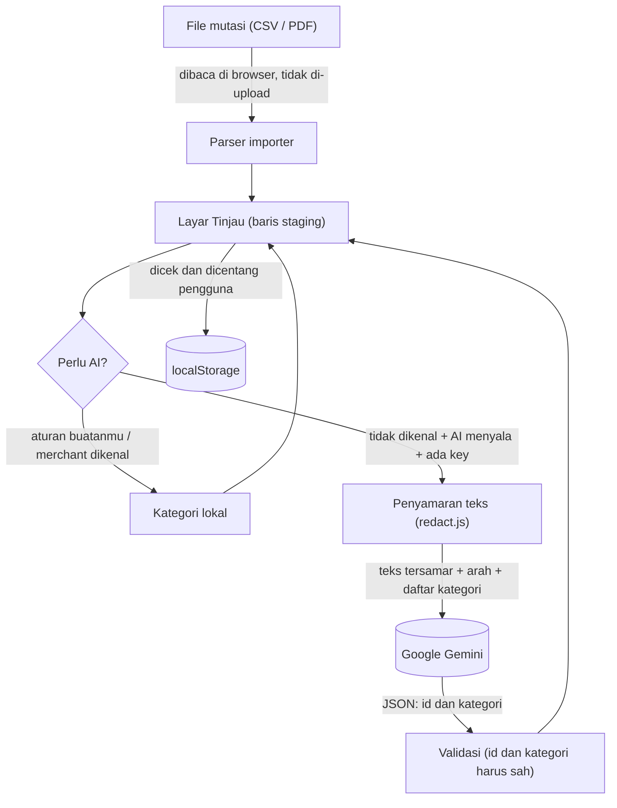

# Arus

Pencatat keuangan pribadi yang **local-first**: datanya tinggal di perangkat, tanpa akun dan tanpa server.
Proyek portofolio — dari satu file HTML 7.900 baris untuk HP, dirombak jadi aplikasi web Vite yang rapi,
punya layout desktop, tampilan glassmorphism, dan kategori transaksi otomatis lewat Gemini yang
mengutamakan privasi.

### 🔗 Live demo: **[arusss.vercel.app](https://arusss.vercel.app)**

Tanpa akun, tanpa instalasi. Buka lalu klik **"Lihat data contoh"** untuk mencoba semua fitur.
Data setiap pengunjung tersimpan **di browser pengunjung itu sendiri**, bukan di server. Fitur AI bersifat opsional dan
memakai API key Gemini milik pengguna sendiri (lihat [Alur API key](#alur-api-key)).

**Ringkasnya:**
- **Privasi:** semua pemrosesan (membaca CSV/PDF, menghitung saldo) terjadi di browser. Satu-satunya data yang
  bisa keluar adalah teks transaksi yang sudah disamarkan, ke Google, dan hanya kalau pengguna menyalakan fitur AI.
- **API key:** milik pengguna, disimpan di browsernya sendiri, dikirim langsung ke Google. Aku tidak punya key
  bersama yang bisa bocor atau disalahgunakan.
- **AI:** hanya dipanggil untuk transaksi yang tidak dikenali aturan lokal, jawabannya dipaksa memilih dari
  kategori milik pengguna lalu divalidasi, dan hasilnya selalu ditinjau manusia sebelum dicatat.


| | |
|---|---|
|  |  |
|  |  |

<p>
  
  
</p>

## Fitur
- **Dasbor:** ringkasan bulan, pita komposisi pengeluaran per kategori, anggaran, tujuan menabung.
- **Transaksi:** cari, filter kategori, transfer antar akun, transaksi rutin.
- **Akun:** kekayaan bersih, alokasi aset vs target, utang, tren kas 6 bulan. Lima akun: GoPay, BCA, OVO, Cash, dan **GoPay Later** (akun utang: saldo minus otomatis masuk ke Utang, bukan Kas).
- **Impor:** CSV bank (BCA), PDF mutasi BCA, **PDF e-statement GoPay**, Bybit, nilai portofolio. Ada layar Tinjau, deteksi duplikat, dan undo.
- **Jurnal trading:** hasil bersih, R-multiple, win rate, profit factor, expectancy.
- **Kategori AI (opsional):** menebak kategori baris impor yang tidak dikenali. Lihat bagian keputusan desain.
- **Lainnya:** kunci PIN, ekspor/impor JSON, sinkronisasi ke servermu sendiri, riwayat perubahan.
- **Desktop:** sidebar kaca, dua kolom, form jadi dialog, shortcut `N` (tambah) dan `1`–`5` (pindah halaman).
- **PWA:** bisa di-install, dan tetap tampil saat offline.

## Teknologi
Vanilla JS (ES modules, tanpa framework) · Vite · CSS murni (token, `backdrop-filter`, tanpa library UI) ·
Vitest + jsdom · Node 18+ (server proxy opsional, tanpa dependency) · Google Gemini API.

## Menjalankan
```bash
npm install
npm run dev       # http://localhost:5173  (jangan buka index.html langsung / Live Server)
npm test          # 80 tes
npm run build     # hasil ke dist/
```
Saat pertama dibuka, pilih **"Lihat data contoh"** untuk mencoba tanpa mengisi apa pun.

## Deploy
Demo di atas dideploy di Vercel. Static hosting biasa. **Vercel / Netlify:** build `npm run build`, folder `dist`, tanpa konfigurasi lain.
**GitHub Pages:** `BASE_PATH=/nama-repo/ npm run build`, lalu publikasikan `dist/`.
CI (`.github/workflows/ci.yml`) menjalankan tes dan build di setiap push.

## Arsitektur Kategori AI

Prinsip utamanya: **aturan lokal dulu, AI hanya untuk sisanya, manusia yang memutuskan.**



**Urutan kerjanya saat impor**
1. Parser membaca file di browser dan membuat baris staging (tampil di layar Tinjau).
2. Setiap baris ditebak lebih dulu secara lokal: aturan yang pernah kamu buat (`catRules`), lalu daftar merchant.
3. Baris yang masih tidak dikenal, dan memenuhi semua syarat berikut, dikirim ke AI: fitur AI menyala, ada
   key, bukan transfer antar akunmu, punya keterangan asli, dan belum pernah ditanyakan (`needsAI`).
4. Keterangan asli disamarkan (`redact.js`), lalu dikirim per 40 baris dengan batas waktu 20 detik.
5. Gemini dipaksa menjawab larik `{id, kategori}` dengan `kategori` hanya boleh salah satu kunci milikmu
   (JSON schema `enum`). Jawaban divalidasi lagi: id asing dan kategori di luar daftar dibuang.
6. Hasil yang lolos ditandai **"Kategori disarankan AI — periksa dulu"** di layar Tinjau. Kalau kamu mengubah
   kategorinya sendiri, pilihanmu yang menang dan AI tidak menimpanya.
7. Baru setelah kamu mencentang dan menekan "Catat", transaksi masuk ke penyimpanan.

**Kalau gagal** (offline, key salah, kuota habis, model hilang): muncul pesan yang menjelaskan sebabnya, dan impor
tetap jalan dengan kategori bawaan. AI tidak pernah menghalangi pencatatan.

**Kenapa dirancang begini**
| Keputusan | Alasan |
|---|---|
| Aturan lokal dulu, AI untuk sisanya | Lebih murah, lebih cepat, dan lebih sedikit data yang keluar |
| Jawaban dipaksa `enum` + divalidasi | Teks transaksi dari pihak luar bisa berisi "perintah" (prompt injection). Kasus terburuknya hanya salah kategori, bukan model melakukan hal lain |
| Tinjau manusia sebelum dicatat | AI bisa salah; angka keuangan tidak boleh berubah tanpa sepengetahuan pengguna |
| Prompt menandai teks transaksi sebagai *data* | Lapisan tambahan terhadap prompt injection |
| Tidak mengirim parameter sampling (`temperature`, dll.) | Google menandainya deprecated di model terbaru |
| Alias model `gemini-flash-latest` sebagai bawaan | Model lama (mis. `gemini-2.5-flash`) sudah mulai dipensiunkan; alias tidak ikut basi |

**Peta kode**
| File | Tugas |
|---|---|
| `src/features/categorize.js` | Aturan lokal: `catRules`, daftar merchant, `isUnsure` |
| `src/features/redact.js` | Penyamaran teks sebelum keluar dari perangkat |
| `src/features/aiShared.js` | Prompt, bentuk request + schema `enum`, validasi jawaban, validasi nama model |
| `src/features/aiConfig.js` | Penyimpanan izin, key, dan model (milik perangkat) |
| `src/features/aiCategorize.js` | `needsAI`, panggilan ke Google, tes koneksi, daftar model, mengisi baris staging |
| `src/sheets/ai.js` | Dialog Kategori AI (simpan key, tes, pilih model, nyalakan/matikan) |
| `server/index.js` | Proxy Gemini opsional untuk pemakaian pribadi (lihat tabel mode di bawah) |

## Alur API key

Arus memakai pola **BYOK** (*bring your own key*): tiap pengguna menempelkan API key Gemini miliknya sendiri.

**Daur hidup key**
1. **Ambil key** di [Google AI Studio](https://aistudio.google.com/apikey). Formatnya kini berawalan `AQ.…`
   (format lama `AIza…`; keduanya diterima validasi di app karena yang menentukan adalah tes koneksi).
2. **Tempel** di *Lainnya → Kategori AI → Simpan key*. Pengecekan lokal hanya menangkap salah tempel
   (kosong, ada spasi di tengah, terlalu pendek/panjang); spasi dan kutip di pinggir dibuang otomatis.
3. **Tersimpan** di `localStorage` browser dengan nama `arus-ai-v1`, berisi `{ on, key, model }`. Ini penyimpanan
   **terpisah dari data aplikasi**, jadi key tidak pernah ikut ekspor JSON, cadangan, atau sinkronisasi
   (dibuktikan oleh tes). Setelah tersimpan, layar hanya menampilkan 4 karakter terakhir.
4. **Tes koneksi** mengirim satu contoh tetap (`INDOMARET`), bukan catatanmu. Kalau gagal, pesannya spesifik:
   key ditolak (400/401/403), model tidak ditemukan (404), kuota habis (429), Google bermasalah (5xx), atau
   browser tidak bisa menjangkau Google (offline/CORS).
5. **Nyalakan** kategori AI. Izin ini juga milik perangkat itu; pindah ke perangkat lain berarti mulai dari mati.
6. **Dipakai saat impor:** browser mengirim request langsung ke Google:
   ```
   POST https://generativelanguage.googleapis.com/v1beta/models/<model>:generateContent
   x-goog-api-key: <key milik pengguna>
   ```
   Key dikirim lewat **header**, tidak pernah di URL, isi request, atau log.
7. **Hapus key** kapan saja: AI otomatis ikut mati.

**Dua jalur pemanggilan**
| | Key sendiri (jalur utama) | Server Arus (opsional, pemakaian pribadi) |
|---|---|---|
| Siapa yang memegang key | Pengguna, di browsernya | Pemilik server, di `.env` |
| Rute data | Browser → Google | Browser → `server/index.js` → Google |
| Cocok untuk | Demo publik dan pengguna umum | Pemakaian pribadi di mesin sendiri |
| Menyalakan | Otomatis kalau ada key | `VITE_AI_SERVER=1` + `npm run server` |
| Pengaman tambahan | CSP di build produksi | Batas per IP/menit dan harian, `ALLOWED_ORIGIN`, tidak ada log isi transaksi, penyamaran diulang di server |

**Kenapa BYOK, bukan satu key bersama milik pengembang**
- Tidak ada key bersama yang bisa bocor atau disalahgunakan, jadi tidak ada tagihan yang bisa membengkak.
- Tidak ada backend yang menyimpan data keuangan siapa pun, sehingga janji *local-first* tetap utuh.
- Google sendiri mencatat bahwa key di kode sisi-klien bisa diekstrak. Karena itu key yang disimpan di browser
  adalah milik pengguna sendiri dan hanya berisiko untuk dirinya sendiri.

**Risiko yang tersisa (dan penangkalnya)**
- Key disimpan sebagai teks biasa di `localStorage`. Skrip apa pun di origin yang sama, atau orang yang memakai
  browser itu, bisa membacanya. Penangkalnya: CSP di build produksi (skrip hanya dari origin sendiri),
  peringatan di UI agar tidak menyimpan key di perangkat bersama, dan saran memasang batas anggaran untuk key itu di Google.
- Pemakaian key tunduk pada syarat Google milik pengguna: di paket gratis Gemini, Google boleh menyimpan dan meninjau
  isi yang dikirim untuk memperbaiki produknya, sedangkan paket berbayar tidak
  ([syarat terbaru](https://ai.google.dev/gemini-api/terms)).

**Model.** Bawaannya alias `gemini-flash-latest`. Di *Lanjutan* ada tombol **Cek model yang tersedia** yang menanyakan
ke Google model apa saja yang boleh dipakai key-mu (`GET /v1beta/models`), lalu kamu tinggal memilih. Nama yang diketik
dirapikan (`Gemini 3 Flash` menjadi `gemini-3-flash`) dan nama yang tidak valid **ditolak dengan alasan**, tidak diganti
diam-diam, serta tidak bisa dipakai menyelipkan path lain ke URL.

## Privasi

**Data apa berada di mana**
| Data | Lokasi | Keluar dari perangkat? |
|---|---|---|
| Transaksi, saldo, anggaran, tujuan, kategori | `localStorage` browser | **Tidak.** Kecuali kamu sendiri mengekspor JSON atau menyalakan sinkronisasi ke servermu |
| File mutasi (CSV / PDF) | Dibaca di memori browser | **Tidak pernah di-upload** |
| Nomor rekening di header e-statement BCA | — | **Tidak dibaca sama sekali** |
| API key | `localStorage` (`arus-ai-v1`) | Hanya ke Google, lewat header |
| Keterangan transaksi (disamarkan) + arah masuk/keluar | — | **Ke Google, hanya** jika AI menyala, dan hanya untuk baris yang tidak dikenali |
| Nama kategori | — | Ikut terkirim sebagai daftar pilihan (jangan beri kategori nama orang) |
| Nominal, tanggal, saldo, nama akun | `localStorage` | **Tidak pernah** |

**Penyamaran** (`src/features/redact.js`) dijalankan pada keterangan *asli* dari bank, bukan judul yang sudah
dibersihkan:
- email diganti `[email]`; angka berurutan ≥ 6 digit (rekening, telepon) diganti `[no]`; kode referensi panjang
  diganti `[ref]`;
- pada transfer (`TRSF`, `SWITCHING`, `BI-FAST`, `Ditransfer`, dll.) hanya kata jenis dan arah yang disimpan, nama
  penerima dibuang: `SWITCHING DB TRANSFER KE 014 BUDI SANTOSO` menjadi `SWITCHING DB TRANSFER KE [penerima]`;
- teks dipotong 80 karakter. Baris tanpa keterangan asli tidak pernah dikirim.

**Semua tempat di kode yang bisa mengirim data keluar** (hasil audit; tidak ada analytics, pelacak, atau skrip pihak ketiga):
| File | Tujuan | Kapan aktif |
|---|---|---|
| `src/features/aiCategorize.js` | Google Gemini (atau proxy `server/index.js`) | Hanya jika AI dinyalakan pengguna |
| `src/features/sync.js` | Server sinkronisasi **milik pengguna** | Hanya jika pengguna mengisi alamat servernya |
| `src/ui/lockScreen.js` | Server sinkronisasi yang sama (cek PIN) | Hanya jika sinkronisasi diisi |

Hosting (Vercel) melihat permintaan halaman seperti server web pada umumnya, tetapi tidak pernah menerima data transaksi.
Service worker tidak menyimpan cache untuk permintaan lintas origin (Google) maupun `/api/`.

**Cara memverifikasi sendiri**
1. Buka DevTools (F12) → tab **Network**, isi filter `generativelanguage`, lalu jalankan *Tes koneksi* atau impor
   file. Klik request-nya dan lihat **Payload**: pastikan tidak ada nominal, tanggal, atau nama orang. Jangan bagikan
   tab *Headers* karena memuat key.
2. Tab **Application → Local Storage**: lihat `arus-ai-v1` (key di sana) dan data aplikasi di entri terpisah.
3. Jalankan `npm test`. `tests/privacy.test.js` meniru `fetch` lalu memeriksa **isi request mentah** ke Google:
   tidak ada nama, nomor rekening, nominal, atau tanggal; key hanya di header; AI mati berarti nol request keluar.

**Batasan jujur**
- Penyamaran berbasis aturan: nama orang di luar pola transfer bisa lolos (mis. "Bayar utang Budi", atau nama pemilik
  warung di QRIS). Karena itu AI mati secara default.
- Satu temuan yang diperbaiki lewat audit sendiri: penyamaran dulu dijalankan pada *judul yang sudah dibersihkan*,
  padahal pembersihan membuang penanda transfer sehingga tinggal nama penerima. Sekarang yang disamarkan adalah
  keterangan asli (`desc`).
- Data di `localStorage` tidak dienkripsi. PIN adalah kunci layar, bukan enkripsi.
- **Sengaja tidak dibuat** (di luar lingkup proyek portofolio): akun/login, kebijakan privasi, dan batas pemakaian per
  pengguna. Kalau Arus dirilis untuk umum, itu wajib ada, begitu pula persetujuan pengguna sesuai UU PDP (UU 27/2022).

## Keputusan desain

**Kategori AI: privasi dulu.** Data keuangan itu sensitif, jadi AI dirancang supaya kerusakannya kecil kalau ada yang
salah: mati secara default, data minimal, key milik pengguna, jawaban dipaksa `enum`, dan hasil selalu ditinjau
manusia. Detailnya ada di bagian [Arsitektur Kategori AI](#arsitektur-kategori-ai),
[Alur API key](#alur-api-key), dan [Privasi](#privasi).

**Impor e-statement GoPay (PDF).** Format GoPay dikenali otomatis dan diterjemahkan dengan aturan eksplisit
(`src/importers/gopayPdf.js`), bukan ditebak:
- *Tabungan by Jago* -> akun GoPay; *GoPay Later* -> akun GoPay Later (utang); `GoTagihan` -> transfer
  GoPay -> GoPay Later (bayar tagihan).
- *Top up* adalah transfer BCA -> GoPay yang sudah dicatat impor BCA, jadi **dicocokkan** (nominal sama,
  ±2 hari) dan otomatis jadi duplikat; tanpa pasangan ditandai "perlu dicek" dan tidak tercentang, supaya
  tidak dobel. Urutan yang benar: impor BCA dulu, baru GoPay.
- *Coins* bukan rupiah, jadi dilewati. Pembayaran campuran (Coins + metode lain) dicatat penuh di metode non-Coins
  karena statement tidak merinci porsi Coins per transaksi; tidak ada angka yang dikarang.
- **Rekonsiliasi otomatis** dengan total di header statement: pemasukan harus persis sama, dan pengeluaran
  harus sama dengan total keluar dikurangi Coins yang dipakai. Diuji pada statement asli (35 transaksi
  rupiah + 7 baris Coins): cocok sampai rupiah terakhir. Impor ulang file yang sama menghasilkan 100% duplikat.
- Berkas asli berisi data pribadi, jadi tidak ada di repo; tes memakai halaman fiktif dengan tata letak yang sama
  (`tests/fixtures/gopayPages.js`).

**Refactor.** File tunggal dipecah per halaman/fitur dengan skrip berbasis AST (acorn), bukan disalin manual.
Perilakunya dibuktikan identik: 6 halaman dan 15 form dirender dari versi lama dan baru, lalu dibandingkan
byte per byte sebelum desain diubah.

**Tampilan.** Aurora kaca di atas dasar gelap keunguan. Warna bermakna (mint = masuk, merah muda = keluar,
ungu-biru = aksi) dan tiap kategori punya hue stabil (`catHue`) yang dipakai di avatar, chip, bar, dan pita
komposisi. Animasi mati untuk `prefers-reduced-motion`; kaca jadi solid untuk `prefers-reduced-transparency`.

## Keterbatasan (jujur)
- **Format key Gemini berubah.** AI Studio kini menerbitkan key berawalan `AQ.` (authorization key); key lama
  `AIza…` yang tidak dibatasi sudah tidak diterima Google. Validasi di app sengaja longgar soal bentuk key;
  yang menentukan adalah tombol **Tes koneksi**. Beberapa pengguna di forum Google melaporkan key `AQ.` ditolak
  (401) oleh beberapa SDK/klien; dokumentasi resmi menyebut header `x-goog-api-key` untuk REST, yang dipakai Arus.
- Google sendiri mencatat bahwa key di kode sisi-klien bisa diekstrak. Karena itu Arus memakai key milik
  pengguna sendiri (BYOK) dan menyimpannya hanya di perangkatnya, bukan key bersama.
- **GoPay Later butuh saldo awal.** Isi "utang awal" di Akun > Atur saldo awal (diisi positif, disimpan
  sebagai saldo minus), kalau tidak, utang sebelum periode statement tidak ikut terhitung. Statement GoPay juga
  tidak memuat saldo, jadi saldo awal GoPay harus diisi sendiri.
- Top up yang tidak punya pasangan di catatan BCA tidak ikut tercatat sampai kamu mengecek dan mencentangnya.
- Panggilan ke Google baru diuji dengan Google tiruan (tes otomatis dan e2e). Tombol **Tes koneksi** di app
  adalah cara memastikan key dan CORS berfungsi di browsermu. Model bawaan memakai alias `gemini-flash-latest`
  (model lama seperti `gemini-2.5-flash` sudah mulai 404). Di Lanjutan ada tombol **Cek model yang tersedia**
  yang menanyakan ke Google model mana yang boleh dipakai key-mu. Parameter sampling (`temperature`, dll.)
  tidak dikirim karena Google menandainya deprecated di model terbaru.
- Akurasi kategori AI belum diukur pada data bank sungguhan.
- Tampilan baru diperiksa di Chromium headless (1440×900 dan 390 lebar). Belum di Safari iOS / HP Android asli,
  belum ada audit aksesibilitas (kontras teks kecil di atas kaca) dan pengukuran performa blur di HP kelas bawah.
- Penyamaran teks berbasis aturan (lihat [Privasi](#privasi)).
- Data hanya di localStorage; cadangan manual lewat ekspor JSON.
- Kode masih bergaya lama (`var`, state global `DATA`, beberapa file besar seperti `pages/akun.js`).

## Struktur
```
index.html            rangka (sidebar/nav, #main, #sheet)
public/               manifest, ikon, service worker
src/main.js           pintu masuk + window.Arus (dipakai tes)
src/app/              boot.js, render.js (router antar halaman)
src/pages/            dasbor, transaksi, akun, lainnya, impor, trading
src/sheets/           form & dialog: tx, budget, goal, cats, recurring, backup, lock, sync, ai, ...
src/core/             data & hitungan: store, derived, networth, budget, categories, dates, money
src/features/         staging, categorize, ai* (aiShared, aiConfig, aiCategorize, redact), sync, lock, trading, ...
src/importers/        parser: BCA CSV/PDF, GoPay, Bybit, folio, utilitas CSV
src/ui/               toast, sheet, nav, layout (desktop), lockScreen, interactions
src/styles/           CSS per bagian; theme.css = palet & kabut, desktop.css = layout desktop
server/index.js       proxy Gemini opsional
tests/                redact, aiShared, server, smoke test seluruh app
docs/screens/         screenshot untuk README
```
